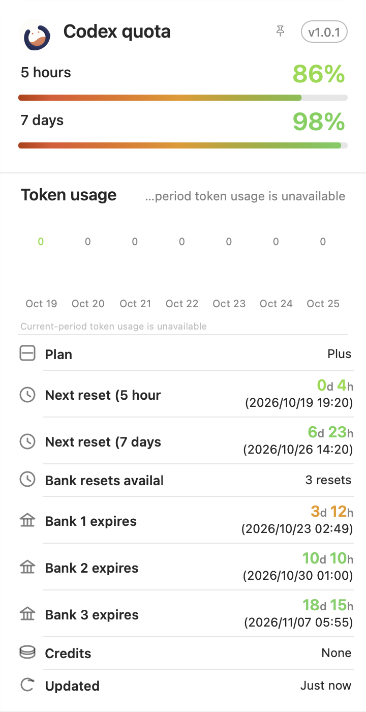
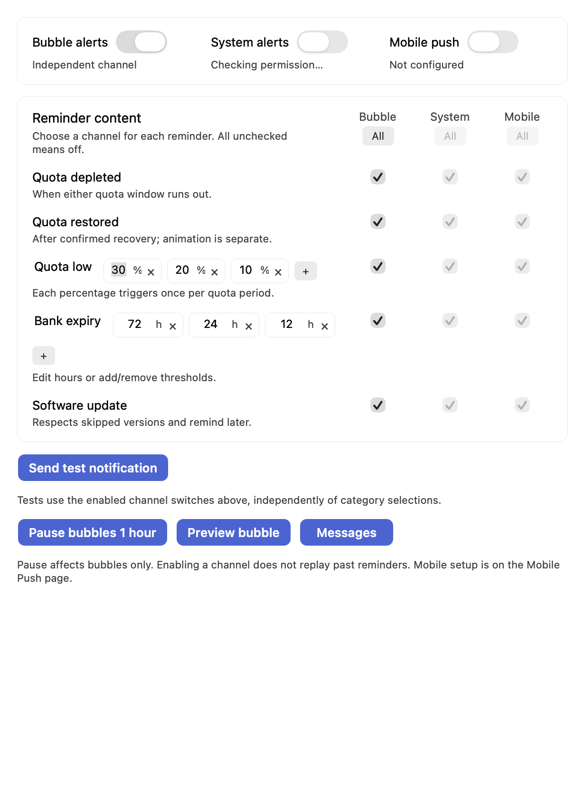
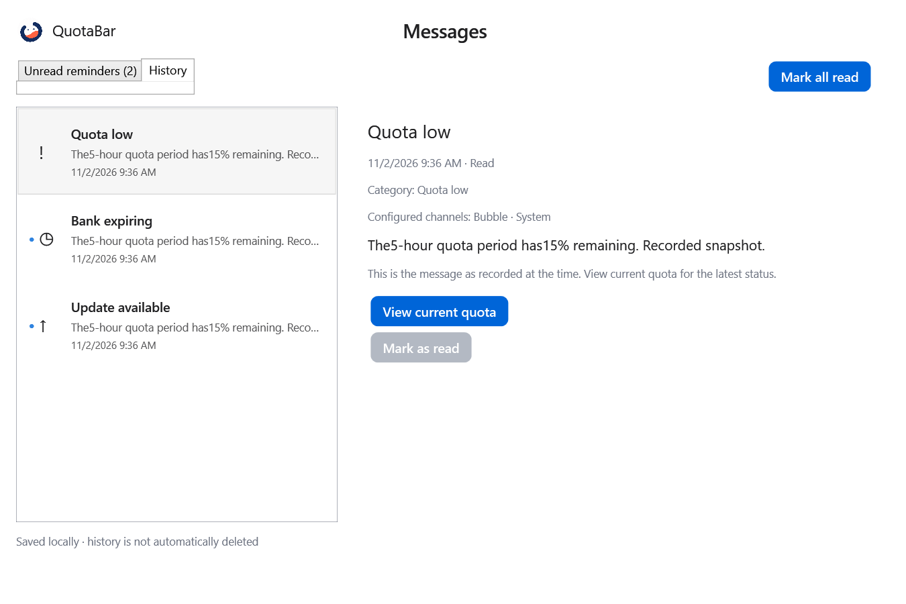
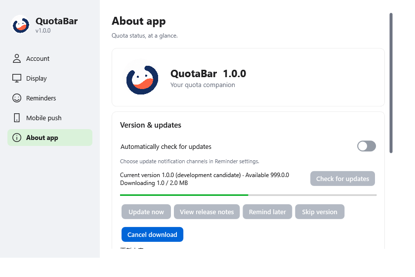
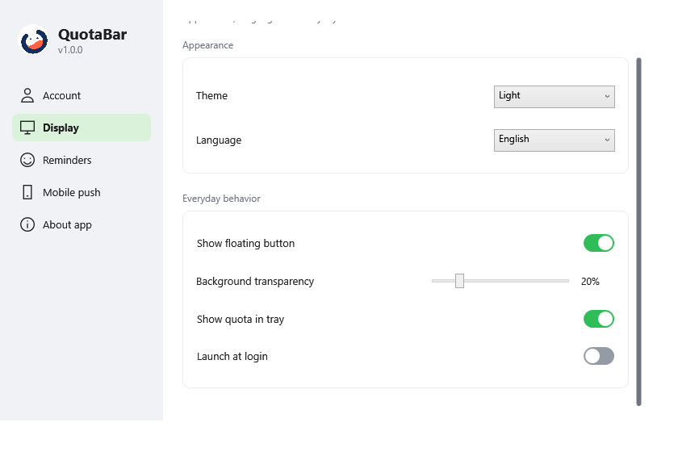

<div align="center">


# QuotaBar

**Keep your Codex quota in sight.**

An independent quota app for macOS and Windows: quota at a glance, configurable reminders, and local message history.

**English** · [简体中文](README.zh-CN.md)

[Download v1.6.0](https://github.com/JaceHwang/QuotaBar/releases/tag/v1.6.0) · [Installation](#installation) · [Documentation](docs/README.md)

</div>

## Meet QuotaBar

QuotaBar bundles the official Codex 0.144.1 runtime and reads quota through an isolated account. Sign in through the official browser flow; it keeps working when Codex desktop is closed. No separate CLI installation or old plugin is required.

### Quota, always within reach

On macOS, show remaining quota and reset dates in the menu bar, or use a monochrome icon. On Windows, a colored tray icon provides quota in its tooltip. Both platforms offer a draggable floating control that remembers its position.


Hover to preview the detail card, click to pin or dismiss it, or lock it open. Details include available quota periods, reset times, Token usage and Bank information. Missing fields are not treated as zero. Quota percentages are account usage limits; Bank is read-only.



These two desktop crops are historical macOS v1.0.1 views. The feature screenshots below are native AppKit/WPF renderings from the current source with example data, captured on 2026-11-02. Fixture version numbers and message contents are examples, not release or account evidence. [Screenshot sources](docs/images/README.md).

### Choose what alerts you, and where

Reminder settings combine five categories with three independent channels: **bubbles, system notifications and mobile push**. Channel switches enable or disable their matrix column. Each column has its own select-all/clear-all shortcut; existing choices survive switching a channel off.



Add, edit or remove low-quota percentages and Bank expiry hours. For example, configure 30%, 20% and 10%, or 72, 24 and 12 hours; the image shows example thresholds, not mandatory defaults. Test notifications follow the enabled channel switches independently of category selections. New installations select all category cells, while system/mobile channel switches start off. See [reminder settings](docs/NOTIFICATION_SETTINGS.zh-CN.md).

### Unread reminders and local history

The **Messages** window has Unread reminders and History tabs. Opening a message marks that message as read; Mark all read clears the unread state without deleting history. Details retain the original snapshot and provide an action to view the current quota or update.



Real messages are saved locally and survive restarts. History is not automatically deleted; previews and test notifications are excluded. Storage failures preserve unread state and expose a retry action. Version 1.6.0 adds a guarded backup/copy path for Windows invalid-handle save failures. [Message-center behavior](docs/MESSAGE_CENTER_VALIDATION.md) · [Recovery](docs/TROUBLESHOOTING.md).

### Download, verify, install and restart

In **About app**, choose Update now to download an official release, verify its size, SHA-256 and source, then install and restart. Download progress is visible; cancellation is available before handoff. Installation or basic startup failure triggers rollback. Automatic checks start about **10 seconds after launch**, then every 24 hours after success; checks never automatically install an update.



The screenshot uses fixture versions 1.0.0 and 999.0.0 to exercise the update controls. Version 1.6.0 fixes macOS download progress and shutdown handoff, retains safe failure diagnostics, and lets the Windows helper take up to 120 seconds to verify/extract the package before declaring it ready. This readiness limit is separate from the 10-second startup check. [Update and recovery guide](docs/IN_APP_UPDATES.zh-CN.md).

### A floating control that fits your desktop

Choose system, light or dark appearance, and adjust **background transparency** with a slider. Only the white/light or black/dark background changes transparency; text and icons stay readable. Hide the floating control with its hover close button and restore it from the menu bar or tray.



Windows drag placement and preferences persist across restarts. macOS settings supports minimizing; its Dock icon remains available while settings is open or minimized. Closing settings keeps QuotaBar running in the background.

### Mobile push and native settings

The five settings pages are Account, Display, Reminders, Mobile push and About app. Bark mobile push is optional and starts disabled. Its Device Key is kept in the operating system credential store. Saving a key does not send a notification; explicit tests use sample content. Service acceptance is not proof that a phone displayed the notification. [Bark setup and data handling](docs/BARK_MOBILE_PUSH.zh-CN.md).

The account is separate from Codex desktop. Quota normally refreshes about every 60 seconds, with backoff after failures. The app does not scan host windows or require Accessibility permission. Choose English, simplified Chinese, traditional Chinese or the system language. [Privacy](docs/PRIVACY.md).

## Installation

Both platforms share **v1.6.0**. Download packages and checksums from the [release page](https://github.com/JaceHwang/QuotaBar/releases/tag/v1.6.0).

| Platform | Download | Support and signing |
| --- | --- | --- |
| macOS Apple Silicon | [DMG](https://github.com/JaceHwang/QuotaBar/releases/download/v1.6.0/codex-quota-v1.6.0-macos-arm64.dmg) | macOS 14+ declared; device-tested on macOS 27.0. Locally signed, not Developer ID notarized. |
| Windows x64 | [Installer ZIP](https://github.com/JaceHwang/QuotaBar/releases/download/v1.6.0/QuotaBar-1.6.0-windows-x64.zip) | Windows 11 x64. Unsigned package. |

For macOS, verify `CODEX-QUOTA-SHA256SUMS.txt`, open the DMG and use the release's installer:

```bash
python3 install-macos-standalone.py install --candidate '/Volumes/QuotaBar/QuotaBar.app'
```

The standard location is `~/Applications/QuotaBar.app`. For Windows, verify `QUOTABAR-WINDOWS-SHA256SUMS.txt`, extract the whole ZIP and run `QuotaBar/setup/QuotaBar.Setup.exe`; the standard location is `%LOCALAPPDATA%\Programs\QuotaBar`. Upgrades preserve the isolated account and settings. Reopen from Finder or the Windows Start menu. Use Quit to stop the app and its runtime.

Versions before 1.4.0 need a one-time manual installation to obtain the update helper. In-app updates require the standard per-user installation. [macOS installation](docs/MACOS_STANDALONE.zh-CN.md) · [Windows installation](docs/WINDOWS_STANDALONE.zh-CN.md).

### Validation scope

Both platforms have native CI for UI, package provenance, startup/exit, installation and update rollback. The user confirmed the related Windows fixes on a physical device before this release; macOS completed an actual in-app upgrade during debugging. These reports do not certify every DPI, minimum OS, multi-monitor or long-running configuration. [Progress and release evidence](docs/PROJECT_PROGRESS-standalone-app.md).

## Development

macOS requires Xcode and the pinned official `codex-cli 0.144.1` binary:

```bash
./governance doctor
./governance check all
CUS_RUNTIME_BINARY=/path/to/codex bash scripts/build-macos-standalone.sh
```

Windows requires .NET 10 SDK and Python:

```sh
dotnet run --project windows/QuotaBar.Core.Tests
python scripts/build-windows-standalone.py
```

Native source/tests live in `native/` and `windows/`; tools live in `scripts/`. Release Please owns product versions; published assets are immutable. Read the roadmap and resume the project board before development. Never commit credentials, runtime binaries or private device screenshots.

[Architecture](docs/ARCHITECTURE.md) · [Documentation](docs/README.md) · [Troubleshooting](docs/TROUBLESHOOTING.md) · [Governance](docs/GOVERNANCE.md)
