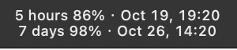
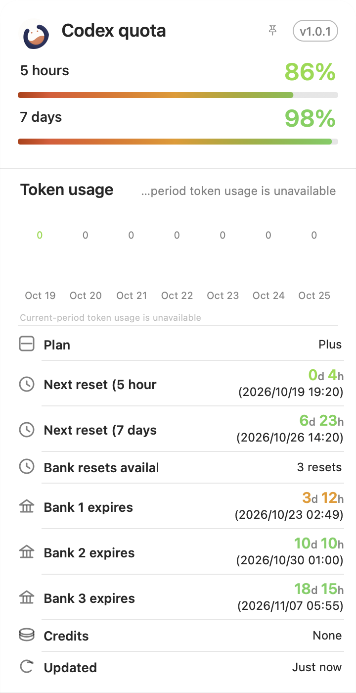
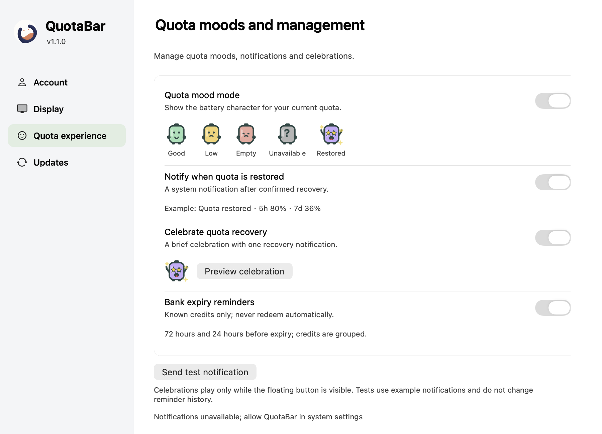
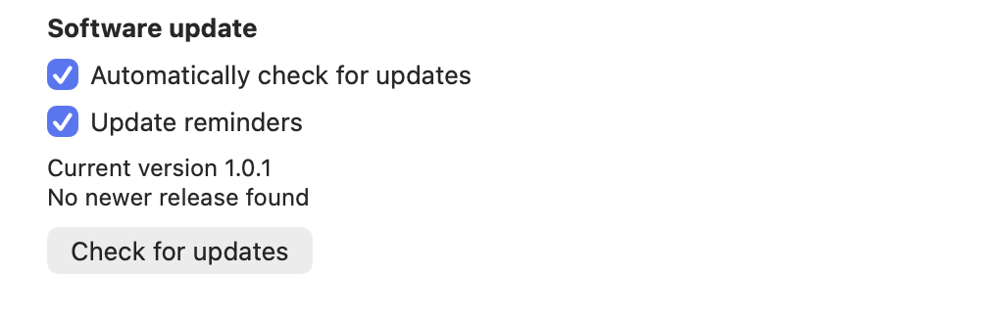

<div align="center">


# QuotaBar

**Keep your Codex quota in sight.**

An independent quota app for macOS and Windows: glance at the menu bar, tray or floating control, then open the details when you need them.

**English** · [简体中文](README.zh-CN.md)

[Download v1.1.0](https://github.com/JaceHwang/QuotaBar/releases/tag/v1.1.0) · [Installation](#installation) · [Documentation](docs/README.md)

</div>

## Meet QuotaBar

QuotaBar bundles the official Codex 0.144.1 runtime and reads quota through an isolated account. Sign in once through the official browser flow; it keeps working when Codex desktop is closed. No separate CLI installation or old plugin is required.

Floating, menu bar, detail and update screenshots below were captured on macOS v1.0.1 in English. The new sidebar settings image is a native rendering with example data from the tested development candidate. No image contains account credentials; these are macOS views, not Windows screenshots.

### Quota, always within reach

On macOS, show remaining quota and reset dates on two menu bar lines, or switch to a monochrome icon. On Windows, a circular colored tray icon provides quota in its tooltip. Both platforms offer a freely draggable floating control that remembers its position.


The floating control is enabled by default. Close it using the button that appears on hover; restore it from the menu bar or tray's “Show floating button” option. The quota-information setting controls menu bar text on macOS and tooltip quota on Windows.

**Two-line quota in the macOS menu bar**



### A closer look at your limits

Hover the floating control to preview the detail card. Click to pin it, click again to dismiss it, or use the lock to keep it open. Outside clicks dismiss unlocked details.



See remaining quota, reset countdowns and local reset times. Available account, plan, Token usage and Bank information appear in the details. Missing fields are not treated as zero. **Quota percentages are account usage limits, not API cash balances**; Bank is read-only. The screenshot preserves the current interface, including truncated English labels and the Token-data availability message.

### Your account, your preferences

Native settings now use Account, Display, Quota experience and Updates sidebar sections. Sign in or out, refresh quota and reload the runtime from the Account section. Choose system, light or dark appearance; follow the system language or select English, simplified Chinese or traditional Chinese. Optional login startup keeps QuotaBar available after you sign in to your computer.



The app keeps its account separate from Codex desktop. It does not scan host windows or require Accessibility permission. Quota normally refreshes about every 60 seconds, with backoff after failures. See [privacy](docs/PRIVACY.md) for data handling.

### Updates without interrupting your work

Check for updates from the menu or settings, view release notes, postpone a reminder or skip a version. Automatic checks are enabled by default; system notifications are opt-in. Successful background checks recur every 24 hours, with a check about 30 seconds after each launch. Updates open the release page for manual download and installation. See [update behavior](docs/UPDATE_FEED_OPERATIONS.zh-CN.md) (Chinese).



The settings refinement in development uses grouped rows, trailing switches, state-aware account actions and a single celebration preview. Runtime reload lives under Troubleshooting. Public v1.1.0 packages retain their released interface.

## Installation

Both platforms share **v1.1.0**. Download the package and checksum/supporting files from the [latest release](https://github.com/JaceHwang/QuotaBar/releases/latest), and verify the checksum before installing.

| Platform | Download | Support and signing |
| --- | --- | --- |
| macOS Apple Silicon | [DMG](https://github.com/JaceHwang/QuotaBar/releases/download/v1.1.0/codex-quota-v1.1.0-macos-arm64.dmg) | macOS 14+ declared; device-tested on macOS 27.0. Locally signed, **not Developer ID notarized**. |
| Windows x64 | [Installer ZIP](https://github.com/JaceHwang/QuotaBar/releases/download/v1.1.0/QuotaBar-1.1.0-windows-x64.zip) | Windows 11 x64. **Unsigned** package. |

### macOS

Verify `CODEX-QUOTA-SHA256SUMS.txt`, open the DMG, and use the attached installer for upgrades and migration:

```bash
python3 install-macos-standalone.py install --candidate '/Volumes/QuotaBar/QuotaBar.app'
```

The default location is **`~/Applications/QuotaBar.app`**. To reopen after quitting, press **Command + Shift + G** in Finder, enter `~/Applications`, and double-click QuotaBar. Reopening a running app shows settings. First launch may require approval in macOS Privacy & Security.

The installer preserves the isolated account and preferences, supports transaction recovery and rollback, and migrates the previous `Codex Quota.app` name. See the [macOS installation guide](docs/MACOS_STANDALONE.zh-CN.md) (Chinese).

### Windows

Verify `QUOTABAR-WINDOWS-SHA256SUMS.txt`, extract the **whole ZIP**, and run:

```text
QuotaBar/setup/QuotaBar.Setup.exe
```

Reopen QuotaBar from the Start menu. Upgrades and rollback preserve the account and settings. See the [Windows installation guide](docs/WINDOWS_STANDALONE.zh-CN.md) (Chinese).

On both platforms, closing settings keeps the app running. Use **Quit** to stop QuotaBar and its bundled runtime.

### Validation scope

The quota experiences and sidebar settings passed native CI on both platforms, including packaging, owned runtime startup/exit and Windows installation lifecycle checks. The user confirmed local device testing passed on both macOS and Windows on2026-10-21. That report does not certify every DPI, minimum-OS, multi-monitor, accessibility or long-running scenario; see the [progress record](docs/PROJECT_PROGRESS-standalone-app.md).

## Development

macOS requires Xcode and the pinned official `codex-cli 0.144.1` binary for packaging:

```bash
./governance doctor
./governance check all
CUS_RUNTIME_BINARY=/path/to/codex bash scripts/build-macos-standalone.sh
```

Windows requires .NET 10 SDK and Python:

```sh
dotnet run --project windows/QuotaBar.Core.Tests
python scripts/build-windows-standalone.py
```

Native macOS source/tests live in `native/`, Windows source/tests in `windows/`, and installation, packaging and provenance tools in `scripts/`. Formal publishing also runs native startup/exit and installation checks on the target platform. Release Please owns product versions; published assets are immutable.

Before development, read the [roadmap](docs/PROJECT_PROGRESS-standalone-app.md) and resume the project board. Do not commit runtime binaries, credentials or private device screenshots.

[Architecture](docs/ARCHITECTURE.md) · [Privacy](docs/PRIVACY.md) · [macOS validation](docs/validation/macos-standalone.md) · [Troubleshooting](docs/TROUBLESHOOTING.md) · [Repository governance](docs/GOVERNANCE.md)

## Quota moods and reminders

Four settings are enabled by default; saved opt-outs remain unchanged:

- **Quota mood:** a larger floating battery character shows good, low, exhausted, unavailable and restored states. Numbers remain the primary quota information.
- **Recovery notification:** a recovery must be confirmed by two fresh quota reads. Multiple restored periods produce one message.
- **Recovery celebration:** a brief violet star-eyed battery and local sparkles, with one accompanying recovery notification. Hidden floating controls stay hidden; previews send clearly labeled example notifications.
- **Bank expiry reminder:** known available credits are grouped at72/24 hours before expiry. Missing dates are never guessed and credits are never redeemed automatically.

Enabling either recovery notifications or celebrations permits one notification per confirmed recovery. macOS requests notification permission if undecided; OS notification and Focus settings still apply. Right-clicking the floating control hides quota details before opening its menu. See [privacy](docs/PRIVACY.md) and [troubleshooting](docs/TROUBLESHOOTING.md).
