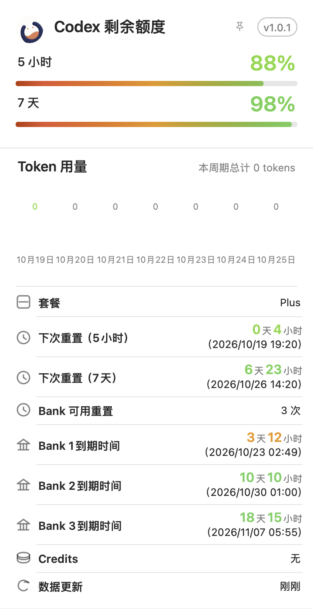
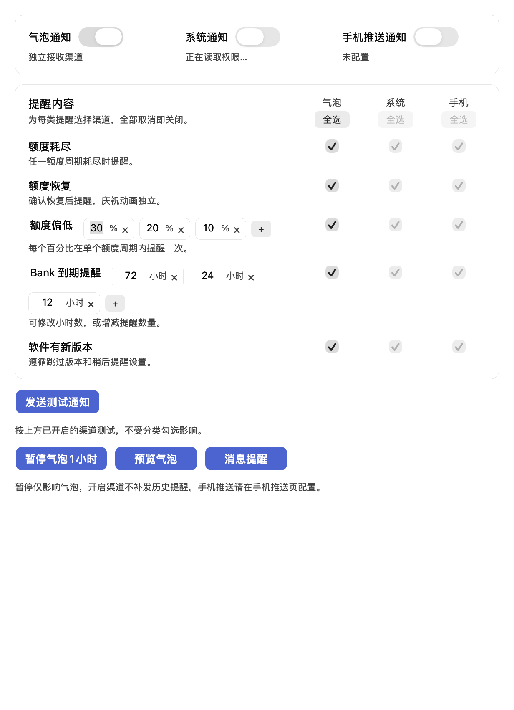
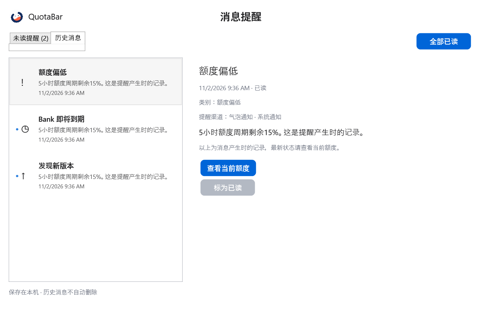
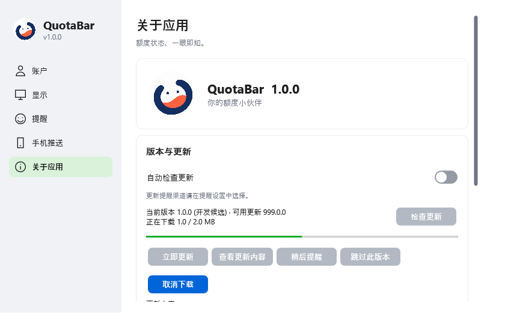
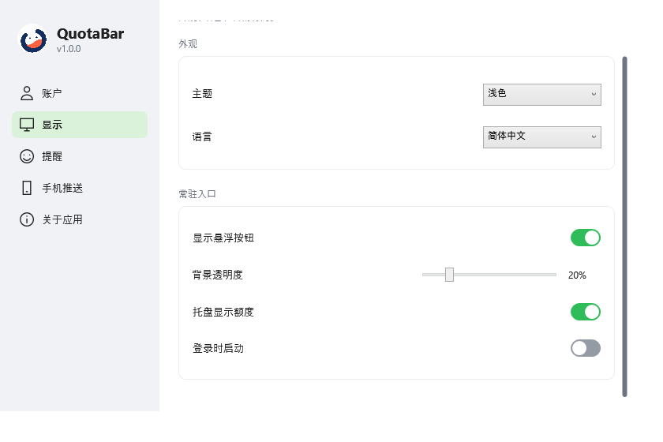

<div align="center">


# QuotaBar

**Codex 还剩多少额度，抬眼就能看见。**

独立运行的 macOS / Windows 额度应用：随时查看额度、自定义提醒，并在本机保存消息历史。

[English](README.md) · **简体中文**

[下载 v1.6.0](https://github.com/JaceHwang/QuotaBar/releases/tag/v1.6.0) · [安装说明](#安装) · [文档索引](docs/README.md)

</div>

## 认识 QuotaBar

QuotaBar 内嵌官方 Codex 0.144.1 运行时，通过隔离账户读取额度。使用官方浏览器流程登录后，即使关闭 Codex 桌面版，也能继续查询；无需单独安装 CLI 或旧插件。

### 额度，随时可见

macOS 菜单栏显示剩余额度和重置日期，也可切换为单色图标。Windows 使用彩色托盘图标，悬停即可查看额度提示。两端均提供可自由拖动、记住位置的悬浮按钮。


悬停预览详情，点击固定或收起，也可锁定展开状态。详情展示可用的额度周期、重置时间、Token 用量和 Bank 信息；缺失字段不当作零。周期百分比表示账户使用限额，Bank 仅供查看。



以上两张桌面图来自历史 macOS v1.0.1。下方功能图为 2026-11-02 从当前源码取得的 AppKit／WPF 原生界面渲染，使用示例数据；图中测试版本号和消息不代表正式版本或真实账户。[截图来源与范围](docs/images/README.md)。

### 提醒内容与接收渠道，自由组合

提醒设置将五类事件与**气泡通知、系统通知、手机推送通知**组合成矩阵。三个总开关分别控制对应列的可交互性；每列的“全选”支持全选和全部取消，关闭总开关会保留原来的勾选。



额度偏低百分比和 Bank 到期小时数均可编辑、添加和删除，例如 30%、20%、10% 或 72、24、12 小时；截图中的阈值仅是示例。测试通知按上方已开启的渠道发送，不受下面分类勾选限制。新安装默认勾选全部分类，系统和手机渠道总开关默认关闭。详见[提醒设置说明](docs/NOTIFICATION_SETTINGS.zh-CN.md)。

### 未读提醒与历史消息，本机保存

“消息提醒”包含“未读提醒”和“历史消息”两个页签。打开一条消息会自动标记该条已读；“全部已读”清空未读状态，不删除历史。详情保留提醒产生时的快照，并提供查看当前额度或更新的入口。



真实消息在本地保存并跨重启保留，历史不自动删除；预览和测试通知不进入历史。保存失败时保留未读状态并提供重试入口。1.6.0 为 Windows 的无效句柄保存错误增加受保护的备份与兼容写入。详见[消息提醒行为与验收](docs/MESSAGE_CENTER_VALIDATION.md)和[故障恢复](docs/TROUBLESHOOTING.md)。

### 在应用内下载、校验、安装并重启

在“关于应用”点击“立即更新”，程序会下载官方版本，核对大小、SHA-256 和来源，再交接安装并重启。下载时显示进度，交接前可取消；安装或基本启动检查失败时回退。自动检查在**启动约 10 秒后**首次执行，成功后每 24 小时检查；自动检查不会自动安装。



截图中的 1.0.0 和 999.0.0 是测试版本，用来展示更新控件。1.6.0 修复 macOS 下载进度和退出交接，保留安全的失败阶段与系统错误码；Windows 助手在报告就绪前可用最多 120 秒核验、解压安装包。这里的 120 秒就绪期限与启动后 10 秒检查是两个独立阶段。详见[应用内更新与回退说明](docs/IN_APP_UPDATES.zh-CN.md)。

### 让悬浮按钮融入桌面

外观支持跟随系统、浅色和深色。“背景透明度”滑块只调整浅色白底／深色黑底，文字和图标保持清晰。悬停时可关闭悬浮按钮，之后从菜单栏或托盘恢复。



Windows 拖动位置与偏好跨重启保存；macOS 设置窗口支持最小化，打开或最小化设置时保留 Dock 图标。关闭设置后，应用继续在后台运行。

### 手机推送与原生设置

设置包含“账户”“显示”“提醒”“手机推送”“关于应用”五页。Bark 手机推送默认关闭，Device Key 保存在系统安全凭据中；保存 Key 不会发送通知，显式测试使用示例内容。“服务已接受”不代表手机已展示通知。详见[Bark 配置与数据说明](docs/BARK_MOBILE_PUSH.zh-CN.md)。

应用账户与 Codex 桌面版隔离，不扫描宿主窗口，也不需要辅助功能权限。正常约每 60 秒刷新额度，失败后退避重试；语言支持跟随系统、简体中文、繁体中文和英文。详见[隐私说明](docs/PRIVACY.md)。

## 安装

两端共用 **v1.6.0**。请从[发布页](https://github.com/JaceHwang/QuotaBar/releases/tag/v1.6.0)下载安装包及校验文件。

| 平台 | 下载 | 系统与签名 |
| --- | --- | --- |
| macOS Apple Silicon | [DMG 安装包](https://github.com/JaceHwang/QuotaBar/releases/download/v1.6.0/codex-quota-v1.6.0-macos-arm64.dmg) | 声明支持 macOS 14+，已在 macOS 27.0 实测。本地签名，未完成 Developer ID 公证。 |
| Windows x64 | [安装器 ZIP](https://github.com/JaceHwang/QuotaBar/releases/download/v1.6.0/QuotaBar-1.6.0-windows-x64.zip) | Windows 11 x64，安装包未签名。 |

macOS 校验 `CODEX-QUOTA-SHA256SUMS.txt`、打开 DMG 后，使用发布附带的安装器：

```bash
python3 install-macos-standalone.py install --candidate '/Volumes/QuotaBar/QuotaBar.app'
```

标准位置是 `~/Applications/QuotaBar.app`。Windows 校验 `QUOTABAR-WINDOWS-SHA256SUMS.txt`，完整解压 ZIP 后运行 `QuotaBar/setup/QuotaBar.Setup.exe`，标准位置为 `%LOCALAPPDATA%\Programs\QuotaBar`。升级保留隔离账户和设置；可从 Finder 或 Windows 开始菜单重新打开。选择“退出”才会停止应用与运行时。

低于 1.4.0 的版本需先手动安装一次，以获得更新助手。应用内更新要求使用标准每用户安装位置。详见 [macOS 安装说明](docs/MACOS_STANDALONE.zh-CN.md)和 [Windows 安装说明](docs/WINDOWS_STANDALONE.zh-CN.md)。

### 验证范围

两端原生 CI 覆盖界面、包来源、启动退出、安装和更新回退。用户在本次发布前确认相关 Windows 修复在实机完成；macOS 调试中完成过真实应用内升级。这些结果不代表最低系统、所有 DPI、多屏或长期运行组合均已逐项验证。详见[开发进度和发布证据](docs/PROJECT_PROGRESS-standalone-app.md)。

## 开发

macOS 需要 Xcode 和固定的官方 `codex-cli 0.144.1` 二进制：

```bash
./governance doctor
./governance check all
CUS_RUNTIME_BINARY=/path/to/codex bash scripts/build-macos-standalone.sh
```

Windows 需要 .NET 10 SDK 和 Python：

```sh
dotnet run --project windows/QuotaBar.Core.Tests
python scripts/build-windows-standalone.py
```

原生源码和测试分别位于 `native/`、`windows/`，工具位于 `scripts/`。产品版本由 Release Please 管理，已发布资产不可覆盖。开发前读取路线图并恢复项目看板；不要提交凭据、运行时二进制或私人设备截图。

[架构](docs/ARCHITECTURE.md) · [文档索引](docs/README.md) · [故障排查](docs/TROUBLESHOOTING.md) · [仓库治理](docs/GOVERNANCE.md)
