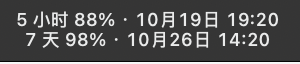
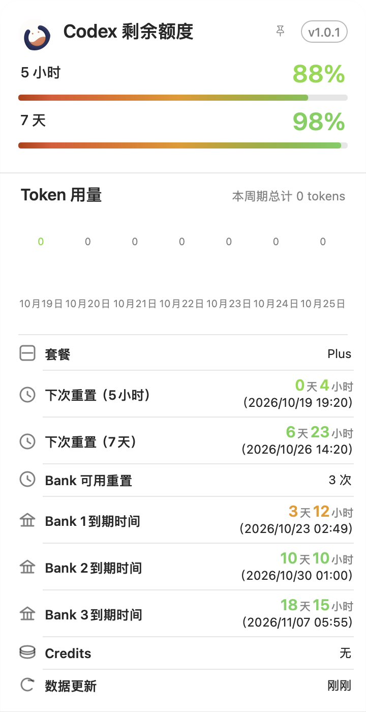
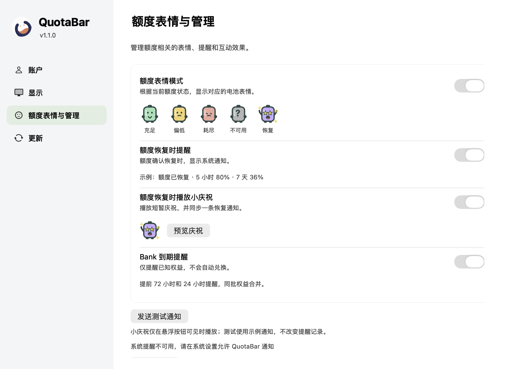
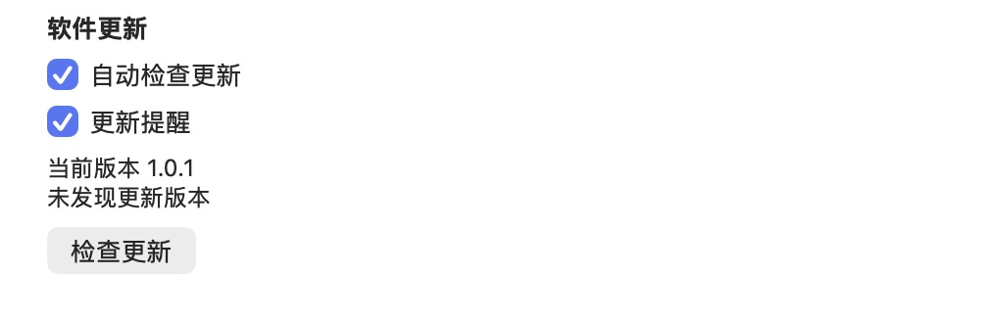

<div align="center">


# QuotaBar

**Codex 还剩多少额度，抬眼就能看见。**

独立运行的 macOS / Windows 额度应用。在菜单栏、托盘或悬浮按钮查看额度，需要时再展开详情。

[English](README.md) · **简体中文**

[下载 v1.2.0](https://github.com/JaceHwang/QuotaBar/releases/tag/v1.2.0) · [安装说明](#安装) · [文档索引](docs/README.md)

</div>

## 认识 QuotaBar

QuotaBar 内嵌官方 Codex 0.144.1 运行时，通过隔离账户读取额度。使用官方浏览器流程登录后，即使关闭 Codex 桌面版，也能继续查询；无需单独安装 CLI 或旧插件。

浮窗、菜单栏、详情和更新配图来自 macOS v1.0.1；侧栏设置图为已验证布局的原生界面渲染，使用发布前测试宿主和示例数据；图中样例版本号不是当前发布版本。配图不包含凭据，也不代表 Windows 界面。

### 额度，随时可见

macOS 菜单栏以两行显示剩余额度和重置日期，也可切换为单色图标。Windows 使用圆形彩色托盘图标，悬停即可查看额度提示。两端都提供可自由拖动、记住位置的悬浮按钮。


悬浮按钮默认开启，悬停时出现关闭按钮；关闭后，可在菜单栏或托盘菜单中选择“显示悬浮按钮”恢复。设置中的额度信息开关，在 macOS 控制菜单栏文字，在 Windows 控制托盘提示中的额度。

**macOS 菜单栏两行额度显示**



### 展开，了解每个额度周期

悬停悬浮按钮预览详情卡，点击固定，再次点击收起；使用锁按钮可保持打开。未锁定时，点击外部会收起详情。



查看剩余额度、重置倒计时和本地重置时间，以及数据可用时的账户、套餐、Token 用量和 Bank 信息。缺失字段不会被当成零。**周期额度不是 API 现金余额**，Bank 信息仅供查看。

### 独立账户，熟悉的原生设置

设置分为“账户”“显示”“额度表情与管理”“更新”四个侧栏页面。设置采用统一右侧原生开关和分组布局；账户操作按登录状态显示，重新加载运行时位于“故障排查”，表情页仅保留额度相关选项和单一预览入口。切换语言会更新状态提示，无障碍切换也会保存偏好。外观支持跟随系统、浅色和深色；语言支持跟随系统、简体中文、繁体中文和英文，还可选择登录电脑后自动启动。



应用账户与 Codex 桌面版隔离，不扫描宿主窗口，也不需要辅助功能权限。正常情况下约每 60 秒刷新额度，失败后退避重试。数据处理方式见[隐私说明](docs/PRIVACY.md)。

### 更新提醒，按自己的节奏处理

从菜单或设置检查更新、阅读更新内容，也可稍后提醒或跳过某个版本。自动检查默认开启，系统提醒默认关闭；每次启动约 30 秒后检查，成功后每 24 小时检查一次。更新入口打开发布页，由你手动下载和安装，详见[更新行为说明](docs/UPDATE_FEED_OPERATIONS.zh-CN.md)。



## 安装

两端共用统一版本 **v1.2.0**。请从[最新版本发布页](https://github.com/JaceHwang/QuotaBar/releases/latest)下载安装包、校验文件及辅助文件，校验后再安装。

| 平台 | 下载 | 系统与签名 |
| --- | --- | --- |
| macOS Apple Silicon | [DMG 安装包](https://github.com/JaceHwang/QuotaBar/releases/download/v1.2.0/codex-quota-v1.2.0-macos-arm64.dmg) | 声明支持 macOS 14+，已在 macOS 27.0 实测。本地签名，**未完成 Developer ID 公证**。 |
| Windows x64 | [安装器 ZIP](https://github.com/JaceHwang/QuotaBar/releases/download/v1.2.0/QuotaBar-1.2.0-windows-x64.zip) | Windows 11 x64，安装包**未签名**。 |

### macOS

校验 `CODEX-QUOTA-SHA256SUMS.txt`，打开 DMG；升级或迁移时使用附带的安装器：

```bash
python3 install-macos-standalone.py install --candidate '/Volumes/QuotaBar/QuotaBar.app'
```

默认安装位置为 **`~/Applications/QuotaBar.app`**。退出后，在 Finder 按 **⌘⇧G**，输入 `~/Applications`，双击 QuotaBar 即可重开；重复打开正在运行的应用会显示设置。首次启动可能需要在系统“隐私与安全性”中批准。

安装器保留隔离账户与偏好，支持事务恢复和回退，也支持从旧名 `Codex Quota.app` 迁移。详见 [macOS 安装说明](docs/MACOS_STANDALONE.zh-CN.md)。

### Windows

校验 `QUOTABAR-WINDOWS-SHA256SUMS.txt`，**完整解压 ZIP**，然后运行：

```text
QuotaBar/setup/QuotaBar.Setup.exe
```

退出后可从开始菜单搜索 QuotaBar 重开。升级和回退保留账户及设置，详见 [Windows 安装说明](docs/WINDOWS_STANDALONE.zh-CN.md)。

两端关闭设置窗口后都会继续常驻；选择“退出”才会停止 QuotaBar 及其内嵌运行时。

### 验证范围

新版额度体验和侧栏设置已通过双端原生 CI，包含打包、自有运行时启动退出及 Windows 安装生命周期检查。2026-10-21 用户确认 macOS 和 Windows 本地实机测试通过；该反馈不代表最低系统、全部 DPI、多屏、无障碍及长期矩阵均有逐项证据，详见[进度记录](docs/PROJECT_PROGRESS-standalone-app.md)。

## 开发

macOS 打包需要 Xcode 和固定的官方 `codex-cli 0.144.1` 二进制：

```bash
./governance doctor
./governance check all
CUS_RUNTIME_BINARY=/path/to/codex bash scripts/build-macos-standalone.sh
```

Windows 需要 .NET 10 SDK 和 Python：

```sh
dotnet run --project windows/QuotaBar.Core.Tests
python scripts/build-windows-standalone.py
```

macOS 源码和测试位于 `native/`，Windows 位于 `windows/`；安装、打包与来源验证工具位于 `scripts/`。正式发布还需在目标平台执行原生启动退出与安装检查。产品版本由 Release Please 管理，已发布资产不可覆盖。

开发前读取[详细路线](docs/PROJECT_PROGRESS-standalone-app.md)并恢复项目看板。请勿提交运行时二进制、凭据或私人设备截图。

[架构](docs/ARCHITECTURE.md) · [隐私](docs/PRIVACY.md) · [macOS 验收](docs/validation/macos-standalone.md) · [故障排查](docs/TROUBLESHOOTING.md) · [仓库治理](docs/GOVERNANCE.md)

## 额度表情与提醒

四项默认开启，已保存的关闭选择继续保留：

- **额度表情模式**：放大的电池角色展示充足、偏低、耗尽、不可用、恢复五种状态，数字仍是主要信息。
- **恢复提醒**：两次新鲜查询确认恢复后通知，同次多个周期合并一条。
- **恢复小庆祝**：紫色星星眼角色和短暂局部星光，同步一条恢复通知。隐藏浮窗不主动显示；预览只发送明确的示例通知。
- **Bank 到期提醒**：提前72／24小时，按已知可用权益合并；缺少日期不猜测，也不自动兑换。

恢复提醒或小庆祝任一开启，同次确认恢复只发一条通知。macOS在权限尚未决定时请求授权，遵循系统通知和勿扰设置。浮窗右键先隐藏详情，再显示选项。详见[隐私](docs/PRIVACY.md)与[故障排查](docs/TROUBLESHOOTING.md)。

### 角色对话提醒

QuotaBar 把恢复、Bank 到期和软件更新提醒接入悬浮按钮旁的角色气泡，支持气泡／系统通知／两者／关闭。原有提醒开关和跳过版本记录保持不变。浮窗隐藏或锁屏时不主动弹出，未读只保留本次运行；气泡可暂停一小时。气泡不自动继承系统免打扰，预览使用示例数据。

本节不表示公开 v1.2.0 已包含这些功能；验证状态见[气泡提醒验收记录](docs/validation/2026-10-22-character-notification-bubbles.md)。

所有应用内气泡在额度不变时持续显示，完整新鲜查询确认使用率变化后收起；仍可主动关闭，原有生命周期关闭条件保留。

## Bark 手机推送

设置新增独立“手机推送”页，可安全保存 Bark Device Key，显式测试后启用。默认关闭，恢复、Bank 到期和软件更新的有效提醒可独立发送到手机；浮窗隐藏、锁屏、暂停气泡或桌面关闭不阻挡手机通道。电脑休眠/退出时无法发送，本地预览不自动推送手机。

Key 仅保存在系统安全凭据中；提醒标题与正文会经 HTTPS 发送到 Bark/APNs。同一事件持久去重，失败不自动重试，“服务已接受”需要用户在手机确认实际展示。详见[配置与数据说明](docs/BARK_MOBILE_PUSH.zh-CN.md)及[验收状态](docs/validation/2026-10-23-bark-mobile-push.md)。本节不表示公开 v1.2.0 已包含该功能。

设置中的“关于应用”位于最后，包含更新功能、GitHub、问题反馈和灰色“待上线”官网入口。“手机推送”提供Key显隐及安装、获取Key、连接测试三步图文向导。设置品牌复用详情圆环，所有操作按钮采用与“获取Bark”一致的高度、字号、圆角和留边，三语言和深浅色同步。详见[设置验收](docs/validation/2026-10-23-settings-about-bark-guide.md)。
