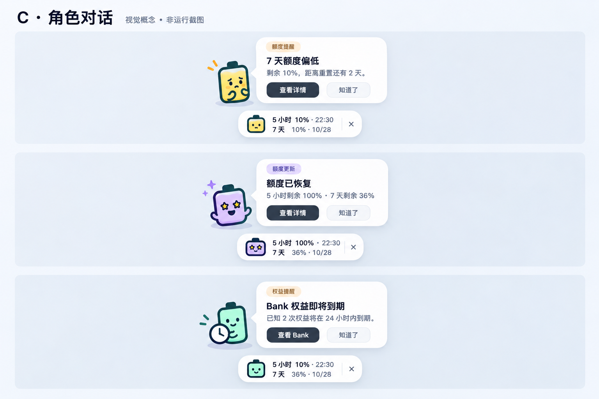

# QuotaBar C 方向角色对话提醒设计

日期：2026-10-22（Asia/Shanghai）  
状态：用户已确认规格与计划；两端实现及本地自动化验证完成，候选与原生CI证据见验收记录。
代码基线：公开 v1.2.0 后的 main `f9264be`。本轮不包含公开发布授权。

## 1. 目标与范围

把现有恢复、Bank 到期、软件更新和示例通知统一接入悬浮按钮旁的角色对话气泡。默认使用应用内气泡，不重复投递系统通知；保留用户主动选择系统通知的能力。

已有四项体验功能及更新提醒开关继续控制是否产生对应提醒，保存的关闭选择保持不变。小庆祝仍与恢复提醒共用一个事件，不产生两条气泡。

不新增低额度预警、消耗预测、额度历史、桌面宠物、自动兑换、自动安装更新或远端服务。概念图中的低额度场景仅展示视觉语言，不表示本轮要实现该功能。

## 2. 已选视觉与不变约束

- 方向：C，电池角色位于对话框左侧，气泡尖角朝向角色；整体锚定现有悬浮按钮。
- 感受：轻松、友好、清晰，避免持续动画和大面积遮挡。
- 保留：现有悬浮按钮高度、双行文字、百分比、关闭热区和拖动行为；通知不得覆盖数字。
- 沿用现有圆角、颜色、字体与电池绘制语言。概念图不是按像素实现规格，不引入截图里的立体渲染作为运行时资源。
- 恢复使用紫色星眼角色，Bank 使用电池加小钟装饰，更新使用电池加小箭头装饰，测试使用恢复角色并带“示例”标签。
- 角色不额外占用鼠标命中区；气泡中的按钮是实际可操作区域。
- 浅色：白色表面、深色文字、浅暖色/紫色标签、柔和阴影。深色：深灰表面、浅色文字和克制的状态色，不直接反转截图。
- 无障碍：可访问名称包含标题和正文；颜色以外同时使用标签和图标表达类型；操作可由菜单/详情中的未读入口用键盘完成。

## 3. 布局与文案

以系统逻辑单位为准，macOS 使用 pt，Windows 使用 DIP。

| 元素 | 规格 |
| --- | --- |
| 角色 | 40×48，视图内绘制，不放大到影响其他控件 |
| 角色与气泡间距 | 8 |
| 气泡主体 | 常规宽 320，紧凑屏幕可缩至 260；总宽包含角色及间距 |
| 内容边距 | 14，标题 13–14 半粗体，正文 12，类别标签 10–11 |
| 圆角与尾部 | 主体圆角 16，左侧小尖角；气泡与浮窗间距 8 |
| 操作 | 主要动作在左，“知道了”在右；最小点击高度 28 |
| 正文 | 自动换行，常规最多三行；Bank 同时两阶段时允许四行；完整内容在详情内可读 |

优先放在按钮上方，角色靠近按钮图标；上方不足翻到下方，横向不足整体平移。位置以按钮所在屏幕工作区为准，四边保留至少 8；角色、气泡和阴影不得落在另一屏或任务栏/Dock 下。狭窄工作区放不下时不缩小字号，改为未读入口。

概念图显示的三个场景是互斥示例，不同时堆放在桌面上。运行时不改变悬浮按钮宽高或加入进度条。

| 类型 | 标题/正文 | 主要动作 | 自动收起 |
| --- | --- | --- | --- |
| 恢复 | 额度已恢复；沿用确认事件的实际周期和百分比，仍耗尽周期明确说明 | 查看详情 | 6 秒 |
| Bank | Bank 权益即将到期；沿用 72/24 小时分组、已知数量、最近到期时间 | 查看 Bank | 10 秒 |
| 更新 | QuotaBar 有新版本 {version}；清单内已验证的摘要，无摘要用通用文案 | 查看更新 | 10 秒 |
| 示例 | 示例通知；明确不影响真实额度与提醒记录 | 查看详情 | 6 秒 |

“查看 Bank”打开详情并定位 Bank；定位不可用时回退详情，不执行兑换。“查看更新”打开经过现有清单验证的发布链接，不自动下载或安装。“知道了”仅关闭该消息，不等于跳过版本、不关闭提醒开关、不隐藏悬浮按钮。

## 4. 交互与生命周期

### 4.1 展示条件与互斥

只有浮窗实际可见、未锁屏、未休眠、未拖动、未打开右键菜单、详情未展开时，才允许自动展示气泡。以当前屏幕上的窗口为依据，不擅自切换 Space/虚拟桌面或穿透其他应用的全屏空间。

- 点击气泡操作先关闭气泡，再打开对应目标。按钮动作只执行一次。
- 鼠标进入气泡或气泡含键盘焦点时暂停剩余时长；离开后恢复，不重新完整计时。
- 外部点击只收起，不执行主要动作；点击现有浮窗仍遵循原详情交互。
- 拖动开始、隐藏/关闭浮窗、打开右键菜单、展开详情、锁屏和休眠立即收起并停止计时；未操作的有效消息回到未读集合。
- 退出应用清理窗口、跟踪区、观察者、所有计时器；退出账户清理旧 epoch 的气泡和未读，软件更新不受账户切换影响。
- 屏幕布局或缩放变化重新计算锚点；气泡存在期间不按帧持续定位。
- 不抢焦点，不激活应用，不移动现有浮窗。键盘用户通过现有菜单/设置的未读入口主动进入可聚焦提醒列表。

### 4.2 动效与庆祝

气泡以约 150ms 淡入，不弹跳、不循环眨眼；收起和取消立即隐藏，防止拖动、切换账户或展开详情后残留。减少动画时直接出现/消失。

真实恢复且庆祝开启时，沿用最多两秒的现有庆祝；紫色角色状态和星光不循环到气泡收起。庆祝关闭时恢复气泡仍可显示紫色静态星眼角色；表情模式关闭也不隐藏气泡角色。气泡和庆祝都不发声。

### 4.3 队列、未读和过时内容

- 全局一次一个气泡。沿用恢复 > Bank > 更新的顺序，同优先级 FIFO，示例只在主动测试时展示。
- 同一消息 ID 不重复入队。活跃气泡不被后来事件抢占，最多排队 32 条，满时优先移除最旧的最低优先级消息。
- 同次多周期恢复、Bank 多阶段沿用事件层原有合并；显示层不自行创造新的恢复事件。
- 恢复超过五分钟不再自动冒泡。Bank 展示前再次确认 epoch、开关、最新完整数据 <=120 秒且权益仍未到期；不通过则丢弃旧气泡，详情仍可查询最新状态。
- 锁屏或浮窗隐藏期间，不自动切到系统通知、不唤出浮窗、不逐条补播。应用菜单/托盘菜单提供“未读提醒（N）”；浮窗恢复可见时在图标旁显示小点，不占用或遮挡数字与关闭热区。
- 点未读入口打开紧凑列表，逐条显示时间、类型和状态；过时恢复显示“曾检测到恢复，请查看最新额度”，过时 Bank 不再保留“即将到期”措辞。记录只反映曾观测事实，不假装数据仍新鲜。
- 未读集合仅当前进程内保存，最多 32 条，最长 24 小时；重启不补发旧恢复。列表顶部说明“仅本次运行”，不称为完整历史。
- 自动收起不算用户已读；主要操作和“知道了”标记已读。气泡已实际展示后不再次自动播放，未读列表仍可查看。原事件去重和 Bank 阶段收据继续独立持久化。

### 4.4 安静时段

应用内气泡不由系统通知中心自动控制，不能声称自动遵循所有平台的免打扰设置。

为保留克制行为，提醒设置提供“暂停气泡 1 小时”和“恢复气泡”；暂停截止时间持久化。暂停期间收录未读，不投递气泡，也不转系统通知；应用重启后按截止时间继续暂停。第一版不加入复杂日程编辑器。

## 5. 设置、迁移和兼容

在“额度表情与管理”中的提醒区域提供统一展示方式：悬浮气泡 / 系统通知 / 两者 / 关闭。各类已有开关继续独立控制事件；“关闭”只关闭提醒展示，不影响额度采集和独立庆祝。

- 无字段的新旧配置默认“悬浮气泡”，既有恢复/庆祝/Bank/更新开关原值保持。更新提醒原本关闭的用户不会因迁移开启更新提醒。
- 仅选择“系统通知”或“两者”时，macOS 主动请求系统通知权限；气泡不依赖系统授权。系统权限拒绝不能阻止气泡或采集。
- 两者模式同一事件分别至多投递一次，两条渠道共享同一语义事件，不因其中一条失败重跑状态机。
- 原 `notifiedVersion`、`skippedVersion`、稍后提醒、Bank 阶段收据全部保留；切换展示方式不重发已通知/已跳过事件。
- 更新 `notifiedVersion` 在首次实际展示气泡或系统接受通知时记录，单纯进入隐藏队列不算投递。旧已通知版本不因新增渠道补弹。
- 加入“预览气泡”测试入口；不自动开启隐藏的浮窗，隐藏时显示说明和“开启悬浮按钮”显式操作。测试消息不修改真实收据、恢复基线或更新 policy。
- 预览庆祝仍同步产生一条示例提醒，使用当前渠道；未授权系统通知时不静默丢掉气泡。
- 简中、繁中、英文同步；设置中“显示系统通知”类文案随渠道调整，不把气泡称为系统横幅。

## 6. 技术接入边界

改造前核对：macOS `AppNotificationRouter` 已接收体验消息，但 `QuotaUpdateController.notifyIfNeeded()` 仍直接调用系统通知中心；Windows `AppNotificationRouter` 已统一体验/更新队列并依赖 NotifyIcon 事件确认展示。

| 层 | 调整 |
| --- | --- |
| Core | 新增展示方式、平台无关队列状态/未读/超时规则、纯锚点布局模型；两端以同一批 JSON 序列验证 |
| AppNotificationRouter | 单一事件入口，拆分系统投递与气泡投递，共用有效性、去重与动作语义；macOS 仍仅一个系统 delegate |
| 原生气泡视图 | AppKit 非激活面板 / WPF 非激活窗口，角色与尾部原生绘制，不加载概念图 |
| Coordinator | 仅提供浮窗锚点、可展示条件、详情状态和导航回调，不嵌入队列算法 |
| UpdateController | 接统一路由，实际展示/系统接受回调记录 policy，保留检查节奏、跳过、稍后提醒和清单验证 |
| ExperienceController | 保留完整观测、恢复确认、Bank 数据新鲜度、事件收据与 epoch 取消，仅替换投递和权限入口 |
| Settings | 渠道选择、暂停、预览、未读入口与三语言说明；沿用已发布设置布局 |

动作使用类型化目的地，不从气泡正文解析 URL。更新 URL 继续严格验证；账户消息点击时再次核验 epoch；已取消的视图回调不能导航到新账户。

## 7. 验收要求

### 自动化

- 配置迁移默认气泡，所有保存的 false 不变；渠道切换/暂停截止持久化。
- 首次基线、重复 ID、恢复确认、Bank 72/24 小时及收据回归，不引入新推断。
- 隐藏/锁屏/休眠/详情/右键/拖动条件下不自动显示；恢复后无逐条补播。
- 超时、悬停暂停、退出清理、活跃消息取消、队列容量/FIFO/优先级、未读到期。
- Bank 失鲜、已过期、epoch 切换、关闭开关、登出后晚到回调都不能误投递或误导航。
- 更新单纯排队不算 notified；真正显示只记录一次；旧 skip/notified/snooze 保持生效。
- 三种真实消息及示例点击目的地正确；两者模式单渠道失败不影响另一渠道。
- 屏幕四边、负坐标、窄工作区、缩放与长英文换行不越界、不遮浮窗数字。
- 系统通知权限拒绝时气泡仍可显示；气泡模式无系统权限请求。
- 关闭表情/庆祝时提醒可独立显示；减少动画无循环刷新；测试入口不改变真实提醒状态。

### 原生与实机

- macOS 浅/深色、三语言、真实浮窗与通知交互、系统权限拒绝、锁屏/休眠、多 Space。
- Windows 原生 CI 与设备分别记录；100/150/200% DPI、多屏、虚拟桌面和 NotifyIcon 更新回归。
- 无焦点抢夺、点击穿透错误、拖动中残留、退出计时器残留；有读屏器和键盘可达入口。
- macOS 结果不作为 Windows 实机证据；自然恢复未遇到则明确记录，只用可控事件验证状态机。
- 执行现有治理完整入口，候选打包安装独立记录。本轮不修改版本号或公开发布。

## 8. 审阅与实施状态

用户已批准规格、实施计划及当前会话原生执行。Core、两端原生气泡与路由、渠道设置及迁移、未读入口均已实现；已有事件检测、账户隔离和收据继续复用。

本地完整治理通过，macOS候选完成签名、DMG、隔离启动退出及准确源码摘要检查。最终原生CI、Windows候选、图片复核与未执行设备矩阵统一记录于[验收记录](../../validation/2026-10-22-character-notification-bubbles.md)。人工Windows硬件、多屏/虚拟桌面、锁屏休眠、读屏器及长期占用不由自动化结果替代。

本轮保留草稿PR，不合并、不公开发布、不替换用户日常安装；公开版本仍为v1.2.0。
